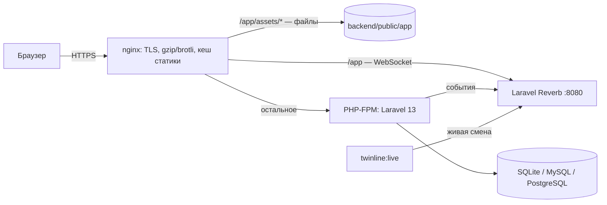

# 8. Развёртывание и производительность

## 8.1. Схема



Laravel обслуживает API (`/api/*`) и отдаёт `index.html` одностраничного приложения для всех остальных адресов. Собранные файлы фронтенда лежат в `backend/public/app` и раздаются веб-сервером напрямую.

## 8.2. Сборка и запуск на сервере

```bash
npm ci && npm run build                     # фронтенд → backend/public/app
cd backend
composer install --no-dev --optimize-autoloader
cp .env.example .env && php artisan key:generate
php artisan migrate --force --seed          # TWINLINE_SEED_DEMO=false — без демо-учёток
php artisan optimize                        # кеш конфигурации, маршрутов, событий и шаблонов
```

Переменные `backend/.env` для эксплуатации:

| Переменная | Значение | Зачем |
|---|---|---|
| `APP_ENV` / `APP_DEBUG` | `production` / `false` | Без отладочной информации в ответах |
| `APP_URL` | `https://twin.example.ru` | Адрес приложения |
| `SESSION_SECURE_COOKIE` | `true` | Cookie сессии только по HTTPS |
| `TWINLINE_SEED_DEMO` | `false` | Не создавать демо-учётки с короткими паролями |
| `DB_CONNECTION` | `pgsql` или `mysql` | Рабочая СУБД вместо SQLite |
| `BCRYPT_ROUNDS` | `12` | Стоимость хеширования паролей |
| `REVERB_APP_KEY` / `REVERB_APP_SECRET` | свои случайные значения | Ключ и секрет приложения Reverb |
| `REVERB_HOST` / `REVERB_PORT` / `REVERB_SCHEME` | `twin.example.ru` / `443` / `https` | Адрес WebSocket для браузера (через nginx, `wss://`) |
| `REVERB_SERVER_HOST` / `REVERB_SERVER_PORT` | `127.0.0.1` / `8080` | Где слушает сам Reverb (только локально) |

## 8.3. nginx

```nginx
server {
    listen 443 ssl http2;
    server_name twin.example.ru;
    root /var/www/twinline/backend/public;

    ssl_certificate     /etc/ssl/twin.crt;
    ssl_certificate_key /etc/ssl/twin.key;

    gzip on;
    gzip_types text/css application/javascript application/json image/svg+xml;
    # brotli on; brotli_types ...;   — если собран модуль ngx_brotli

    # Хешированные файлы сборки: кеш на год, без повторной проверки.
    location /app/assets/ {
        expires 1y;
        add_header Cache-Control "public, immutable";
        try_files $uri =404;
    }

    # WebSocket Reverb: wss://twin.example.ru/app/...
    location /app {
        proxy_http_version 1.1;
        proxy_set_header Host $http_host;
        proxy_set_header Upgrade $http_upgrade;
        proxy_set_header Connection "Upgrade";
        proxy_read_timeout 120s;
        proxy_pass http://127.0.0.1:8080;
    }

    location / {
        try_files $uri /index.php?$query_string;
    }

    location ~ \.php$ {
        fastcgi_pass unix:/run/php/php8.4-fpm.sock;
        fastcgi_param SCRIPT_FILENAME $realpath_root$fastcgi_script_name;
        include fastcgi_params;
    }
}

server {
    listen 80;
    server_name twin.example.ru;
    return 301 https://$host$request_uri;
}
```

`index.html` отдаётся Laravel с `Cache-Control: no-cache`, поэтому после обновления браузер сразу получает новые хешированные файлы. HSTS включается автоматически, когда запрос пришёл по HTTPS.

## 8.4. PHP

`php.ini` для эксплуатации:

```ini
opcache.enable=1
opcache.memory_consumption=128
opcache.validate_timestamps=0      ; после обновления кода — перезапуск PHP-FPM
expose_php=Off
```

## 8.5. Производительность

| Уровень | Что сделано |
|---|---|
| Сборка фронтенда | Разделы загружаются по требованию; библиотеки вынесены в отдельные кешируемые файлы: `vendor-react` (≈ 95 КБ gzip), `vendor-charts` (≈ 108 КБ), `vendor-flow` (≈ 60 КБ), `vendor-three` (≈ 263 КБ, только в 3D-туре). Экрану входа нужно ≈ 120 КБ JS |
| Шрифты | Свои файлы, без внешних CDN; наборы символов подключены через `unicode-range` — браузер скачивает только латиницу и кириллицу |
| Расчёт модели | Чистые функции, кеш по параметрам, < 1 мс на сценарий |
| 3D | Модель из простых фигур без загрузки файлов; общие материалы; статичные детали объединены по материалу (≈ 300 вызовов отрисовки вместо ≈ 2 300); `InstancedMesh` для повторяющихся объектов; пониженный DPR, без теней и мелких деталей на телефоне; `PerformanceMonitor` |
| Сервер | `php artisan optimize`, OPcache, индексы (`users.login`, `users.role`, `scenario_runs.ran_at`, `audit_logs.created_at`), журнал прогонов ограничен 500 записями |
| Сеть | gzip/brotli и долгий кеш статики в nginx, `no-store` для ответов API |

## 8.6. Резервное копирование

SQLite — копирование файла `backend/database/database.sqlite` при остановленной записи (или `sqlite3 .backup`). MySQL/PostgreSQL — штатные `mysqldump` / `pg_dump` по расписанию. В базе нет персональных данных, кроме логинов и IP-адресов в журнале действий и сессиях.

## 8.7. Реальное время (Reverb)

Кроме PHP-FPM постоянно работают два процесса — WebSocket-сервер и поток живой смены. Пример для supervisor:

```ini
[program:twinline-reverb]
command=php /var/www/twinline/backend/artisan reverb:start
autorestart=true
user=www-data

[program:twinline-live]
command=php /var/www/twinline/backend/artisan twinline:live
autorestart=true
user=www-data
```

- После `php artisan optimize` изменения `.env` применяются только после повторного `optimize`.
- В `config/reverb.php` для эксплуатации стоит ограничить `allowed_origins` доменом приложения.
- Поток живой смены синтетический; на реальном предприятии вместо него — источник данных цеха (вне рамок ТЗ: ERP/MES не подключаются).
- Если Reverb не запущен, приложение работает: блок «Линия сейчас» показывает «Нет связи», изменения других пользователей видны после обновления страницы.
